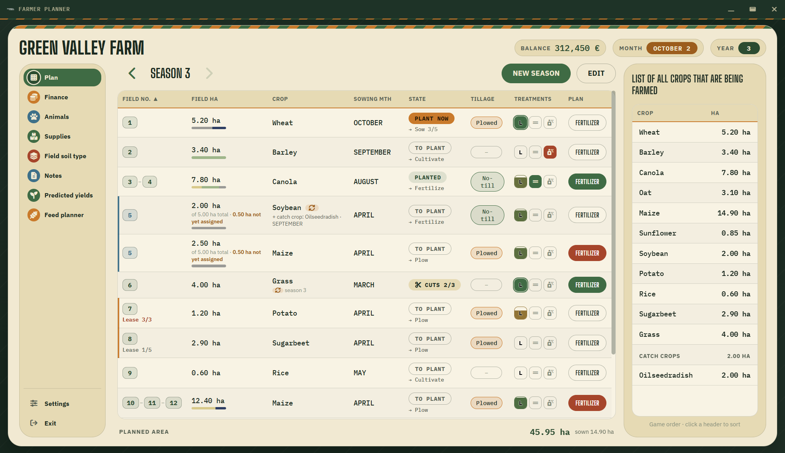
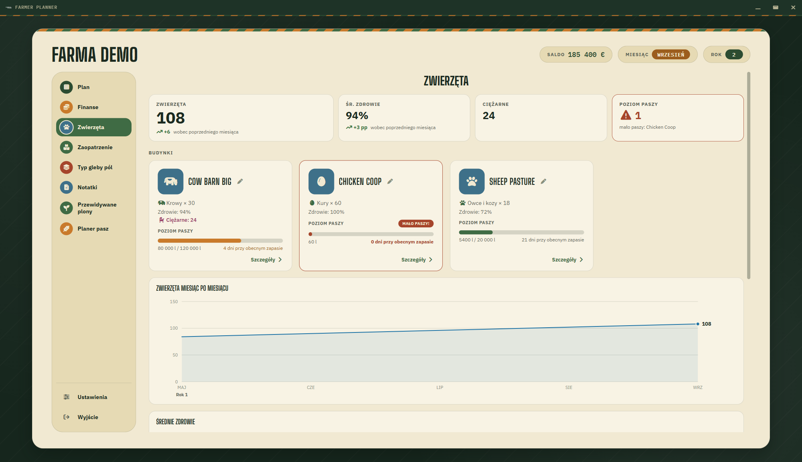

<p align="center">
  <picture>
    <source media="(prefers-color-scheme: dark)" srcset="Assets/Logo.svg">
    
  </picture>
</p>

<h3 align="center">Know what every field needs this month.</h3>

<p align="center">
  A free season planner for <b>Farming Simulator 25 (FS25)</b>. It reads your savegame and keeps fields, crops,<br>
  fertilizer, animals and feed in one plan, updated every time the game saves.
</p>

<p align="center">
  <a href="https://github.com/WiktorParylak/farmer-planner/releases"></a>
  <a href="https://farmerplanner.pl"></a>
  <a href="https://github.com/WiktorParylak/farmer-planner/releases"></a>
</p>

<p align="center">
  <b>English</b> | <a href="README.pl.md">Polski</a>
</p>



## One plan for the whole farm

**Season plan**
- Every field with its area, crop, sowing month, next job, ploughing or no-till, soil type and fertilization plan.
- A field view with everything about one field: crop, rotation, soils (loaded from the game), lime, nitrogen plan and the work list to tick off.
- Catch crops on the same field, before or after the main crop.
- Past seasons kept, so you can step back and compare.
- Crop rotation cycles (from templates like Norfolk or your own): the next crop is filled in when a new season starts, and a rotation view scores each field.
- Seasons that overlap: crops still growing carry over to the new season, and the planner tells you when to start it.
- A *What to do today* panel under the plan: this month's sowing, harvest, weeds, rolling, work steps, low feed and notes.
- A summary of hectares per crop.

**Synced with your game**
- Balance, loans, playtime, equipment and animals read from your savegame.
- Refreshes on its own every time the game saves, autosave included.
- The map's crops and sowing calendar read from the map mod.
- Field soils from Precision Farming, straight from the save.

**Tools**
- Finance month by month and season by season.
- Supplies: how much seed and fertilizer to buy this season.
- Predicted yields, with today's field moisture from Moisture System.
- Notes pinned to months, with tags and a checklist.
- Tramlines: save the tramlines of your fields from one save and paste them into another save of the same map.
- Map scaling: double the resolution of a map mod's density maps, info layers and height map. The app writes the scaled files and a backup of the originals to its own folder; you copy them into the mod yourself.

## Animals and feed, worked out

One tile per barn: the herd by breed and age, how many days the feed lasts, daily needs, output and pregnancies. The feed planner tells you what's missing and how many hectares to sow, and the mixer wagon calculator checks your mix against your map's TMR recipe. Breed norms show what one animal or a whole herd eats and gives at any age.

Works with AnimalFoodCalculator and EnhancedAnimalSystem, and shows breed pictures from your mods.



## Getting started

1. Download the installer from [Releases](https://github.com/WiktorParylak/farmer-planner/releases) , run it and click Install. You can pick the folder and a desktop shortcut; nothing else needs to be installed.
2. Click **Add farm** and enter the farm and map name.
3. Open the farm, go to **Settings** and point it to your savegame's `careerSavegame.xml`, e.g.
   `Documents\My Games\FarmingSimulator2025\savegame1\careerSavegame.xml`.
4. Turn on auto-sync and click **Save & import**.
5. Plan your fields. The planner keeps up while you play.

When a new version is out, the app tells you on start and can update itself: **Update now** downloads the installer and puts the new version in place, and if anything goes wrong the previous version is put back. Your farms are never touched.

Mods are looked up in the `mods` folder next to your savegame, in the folder set in the game's `gameSettings.xml`, and in your FSG Mod Assistant collections. Breed pictures are loaded automatically from there. Base-game animals (packed inside the game's archives) are shown as icons.

## Questions

**Does it change my savegame?**
No. Farmer Planner only reads game files, with one exception you start yourself: the tramlines tool writes the tramlines you paste into the save's `densityMap_fruits.gdm`. It only does that with the game closed, copies the file to `farmer_planner_backup` first, checks the new file before it replaces the old one, and can restore the last backup.

**Which maps and mods does it support?**
Any map: the crops and calendar are read from the map mod your savegame uses. It also understands Precision Farming, AnimalFoodCalculator, EnhancedAnimalSystem, Animal Package (vanilla edition), Moisture System, Crop Dependent Rolling, Bank And Credit and Enhanced Loan System.

**Where are my farms stored?**
In `Documents\Farmer Planner`, so they're easy to find, copy or back up. The app can also export and import a farm backup.

**Does it work in multiplayer?**
Yes. In a save with several farms you choose your own farm in Settings, and the planner reads only its money, land, animals and feed.

<details>
<summary><b>Full feature list</b></summary>

**Season plan**
- Field table: field number (several fields can be combined into one row, e.g. `69-70-71`), hectares, crop, sowing month, the next job in the colour of the field's state (to plant / plant now / overdue / planted; click it when the job is done, right-click to step back), plowed or no-till, lime and nitrogen chips. Click a column header to sort.
- Field view (click the field number): crop, catch crop, rotation, soils with *Load from the game*, pH and lime, notes, the nitrogen plan (requirement, nitrogen in the soil and from manure, what mineral fertilizer still has to cover) and the work list to tick off.
- Work done in the game ticks itself off: with the save connected, cultivating, ploughing, sowing, fertilizing, liming and rolling tick the matching steps.
- Your own field names (*Behind the barn*), kept across seasons, and a search box (**Ctrl+F**) that filters the fields by number, name or crop — handy on big farms.
- Combined fields add up their hectares: typing `10-11-12` fills in the area from the fields' known sizes or the save.
- Catch crops (green rye, oilseed radish…) on the same field, before or after the main crop.
- Seasons with history — step back to previous seasons and compare. A new season keeps fields whose crop is still growing (maize harvested in October while canola goes in in August); they clear themselves after the harvest. *New season* lights up when it's time.
- Crops summary: total hectares per planted crop, filled in from the fields, in the game's crop order (or sorted by name / area); catch crops listed separately.
- Optional whole land plot (farmland) area next to each field's area.
- Crop rotation: cycles per farm (templates such as Norfolk, cereals + canola, dairy feed, or your own, multi-season grass and fallow steps), assigned per field. A new season (or a new in-game month, once a sowing window opens) fills in each field's next crop. The rotation view shows past and planned seasons with a green / yellow / red score and warnings (same crop twice, too many cereals, canola or beet too often, grass past its limit).
- *What to do today* panel under the season plan: fields to sow or harvest this month, late sowings, weeds, rolling, the next step of your work lists, barns low on feed and this month's notes.
- Several fields at once in Edit: tick the cards (or **Shift+click** them) and a change in one selected card goes to all of them, or merge them into one field.
- With the Crop Dependent Rolling mod, rolling is planned only for the crops that need it.

**Game sync**
- Imports balance, loan, playtime, equipment and animals from `careerSavegame.xml` — loans from the Enhanced Loan System and Bank And Credit mods included.
- Auto-sync while you play — the planner refreshes every time the game saves (manual save or autosave).
- The map's crops, their order and sowing calendar read automatically from the map mod the savegame uses — no folder import needed (a map folder can still be picked for maps the app can't read).
- Animal mods that change feed consumption are detected: **AnimalFoodCalculator** (mode, multiplier, days per month, reference curves) and **EnhancedAnimalSystem** (lactation food factor).
- Field soil types from Precision Farming, read straight from the savegame.

**Tools (left sidebar)**
- **Finance** — balance and loan month by month and season by season.
- **Animals** — one tile per building, breed pictures taken from your mods, herd by breed and age, feed level and how many days it lasts, daily needs, output, and reproduction (pregnancy progress, months to birth, animals not inseminated or too young). Buildings can be renamed. **Breed norms** show what one animal or a herd of a breed eats and gives per month at a given age.
- **Supplies** — how much seed and fertilizer to buy for the season.
- **Field soil type** — field soils used by the fertilization plans.
- **Notes** — pinned to months and fields, with tags and a checklist that starts over every in-game year.
- **Predicted yields** — with the Moisture System mod, also today's field moisture, its ideal range and how it changes the yield of this month's harvest.
- **Feed planner** — what you have, what's missing and how many hectares to sow to feed your herd, plus a **mixer wagon** calculator: load it from the bales on your farm and check the mix against the game's TMR recipe. Feed mixer productions (pig food, TMR, mineral feed) are detected with their stock, recipes and monthly output.

**Other**
- English, Polish and German.
- Interactive tutorial (app settings → "Open tutorial").
- Farm backups (export / import).
- A diagnostic file for bug reports (app settings → Help) — the farm and the savegame's small files in one `.json`, with your Windows user folder hidden.
- Discord Rich Presence — shows your current farm on your profile (off until you allow it).

</details>

## For developers

Running from source is only needed if you want to change the code or build the installer yourself. Requires [Node.js](https://nodejs.org/) 20 or newer.

```bash
git clone https://github.com/WiktorParylak/farmer-planner.git
cd farmer-planner
npm install
npm start
```

Build the installer (into `dist/`):

```bash
npm run build
```

```
src/
  main/        Electron main process (window, dialogs, Discord Rich Presence)
  renderer/    UI: index.html, renderer.js (app shell), fields-table.js, feed.js, supplies.js,
               tutorial.js, translations*.js, style.css, savegame & mod readers
data/          Bundled base-game data (default crops, animals, nitrogen by soil)
Assets/        Logo and app icon
tools/         Dev scripts that regenerate the files in data/ from game files
docs/          Logo and screenshots
```

Built with [Electron](https://www.electronjs.org/), plain HTML/CSS/JavaScript and [Font Awesome](https://fontawesome.com/).

## Changelog

See [CHANGELOG.md](CHANGELOG.md) or the [Releases](https://github.com/WiktorParylak/farmer-planner/releases) page.

---

<p align="center">
  Made by Wiktor Parylak · <a href="https://farmerplanner.pl">farmerplanner.pl</a><br>
  <sub>Not affiliated with GIANTS Software. Farming Simulator is a trademark of GIANTS Software GmbH.</sub>
</p>
